# ADR 001: platform renderers, shared contracts

Status: accepted for candidate 0.1.0. Issues #4, #5. Evidence: `evidence/upstream-inventory.json`.

```mermaid
graph TD
  Tokens[HIG tokens] --> Web[HIG React]
  Tokens --> Native[HIG Native]
  Contracts[HIG contracts] --> Web
  Contracts --> Native
  Contracts --> Feedback[optional feedback adapters]
  Web --> Docs[docs and consumer fixtures]
  Native --> Expo[Expo gallery]
```

`@bloxwap/hig-tokens` owns palette, density, units and generation; `@bloxwap/hig-contracts` owns platform-neutral types and formatting. `@bloxwap/hig-react` and `@bloxwap/hig-native` own renderers. `@bloxwap/hig-feedback` owns optional adapter entry points. Base controls never load audio, haptics, charts, Expo or another platform. Each component has an individual export; CSS is explicit and side-effectful. Plain HTML consumers use tokens/CSS alone.

Candidate validation matrix: Node 20.19+, TypeScript 5.9, React/DOM 19.1, RN 0.81.5, Expo 54, Vite 6.4. Next 16.4.0 webpack is verified by M5 production/packed consumer checks. NativeWind remains unverified until source/rem-root evidence exists. Use StyleSheet on RN and plain CSS on web; Tailwind may refer to `var(--hig-*)` without scanning HIG sources. Legacy NativeWind rem roots are unknown until monorepo audit. Never infer native sizes by replacing `rem` with `dp`.

Prefer built-in semantic controls; modal/disclosure behavior must retain keyboard, focus restoration and descriptions. Optional chart entry imports the chart SDK only on the client. Libraries retain upstream licenses; extracted tokens and mark have commit provenance, no vendor engine source is copied. Font binaries remain owned by @bloxwap/font (OFL-1.1).

Deprecation plan: inventory all live references, map variants to intent/density, run migration diff and consumer validation, switch a pilot behind a host flag, then delete unused copies. App comfortable targets and Pro compact rows are intentional. HIG cannot retire inaccessible monorepo copies. API/token/behavior changes follow semver; breaking accessibility behavior counts as breaking. Support upgrades require web, SSR and Metro evidence with a documented rollback before changing the matrix.
