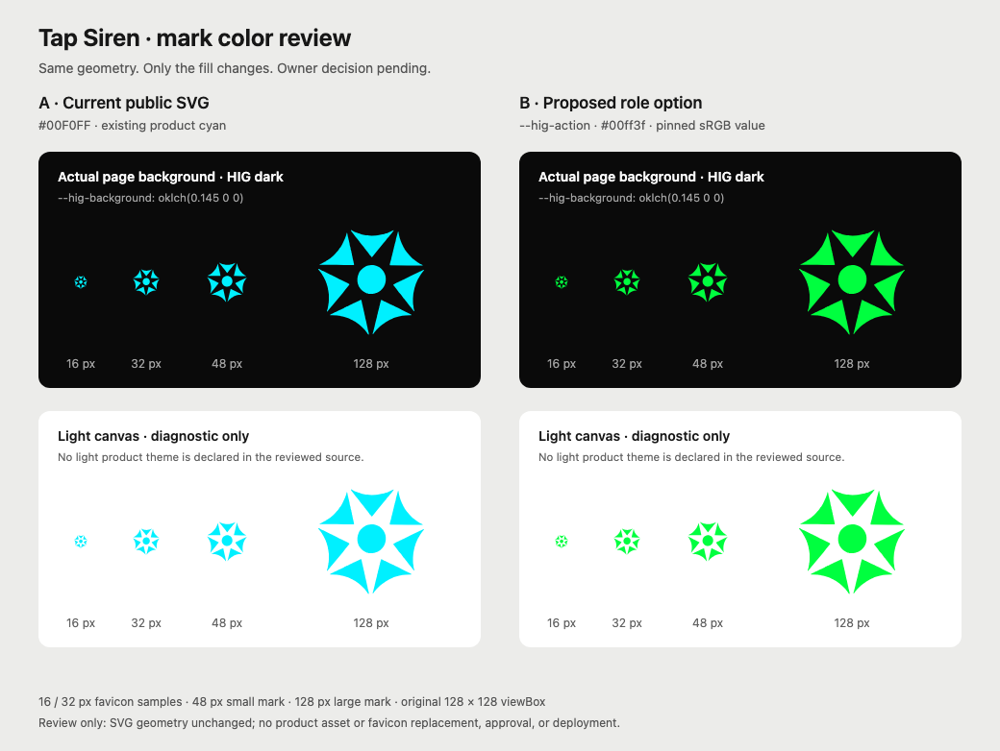

# Tap Siren mark color review

Owner decision pending for [HIG#101](https://github.com/bloxwap/hig/issues/101). These assets make the existing choice reviewable; they do not approve a color or change the product.

- **A — [current-cyan.svg](current-cyan.svg):** exact current public SVG, `#00F0FF`.
- **B — [proposed-hig-action-srgb.svg](proposed-hig-action-srgb.svg):** only `fill` changes to `#00ff3f`, the canonical sRGB value of `--hig-action` / `colors.action.srgb` in clean HIG [`0e239442`](https://github.com/bloxwap/hig/blob/0e2394428a3971e677e0a97ef5259ac4ca1ec064/packages/tokens/source.json). The page and OG already use that role; this option brings the public mark into the same color family if the owner chooses it.
- **[comparison.svg](comparison.svg):** scalable code-native comparison, with both options at 16/32 px favicon sizes, 48 px small, and 128 px large. The PNG is a Chromium render at 1× CSS pixel size.

The actual page background resolves `--hig-background` to `oklch(0.145 0 0)` (sRGB fallback `#0a0a0a`). The reviewed source declares no light product theme, so the white panels are explicitly diagnostic light/browser canvases. The comparison fixes the mark colors to sRGB for portability; the canonical role also has Display P3 channels `[0, 1, 0.24]`, recorded in provenance. This is not physical display or wide-gamut acceptance evidence.

Geometry is exact: one path and the original `128×128` viewBox, without simplification, tracing, cropping or padding changes. The two SVG files differ only in the fill attribute. Path UTF-8 SHA256: `9de0cb78131710603b26cdd3a6a78037d018e8c1dd238427749b0e0c005f54f0`.

Sources: current Tapsiren main [`e921ba88`](https://github.com/bloxwap/tapsiren/blob/e921ba88f4a62a509d049e35525e44f1a96b20f3/workers/tapsiren/public/tap-siren-mark.svg) and candidate [`1894d0e9`](https://github.com/bloxwap/tapsiren/blob/1894d0e90def83abb0eee6a888f6e77b6228919b/workers/tapsiren/public/tap-siren-mark.svg) ([PR#401](https://github.com/bloxwap/tapsiren/pull/401)) have byte-identical public mark and shared page/OG path. [provenance.json](provenance.json) records exact source refs, file hashes, canonical role values, unchanged favicon binary hash, and render settings.

No Tapsiren source, SVG, favicon, route or original checkout was changed. No brand choice, approval, PR, push, deployment or planning change was made. The owner must still choose between approving the separately owned cyan mark or approving recoloring; any eventual ICO regeneration, public-asset drift coverage and adoption update belong to that subsequent approved change.
